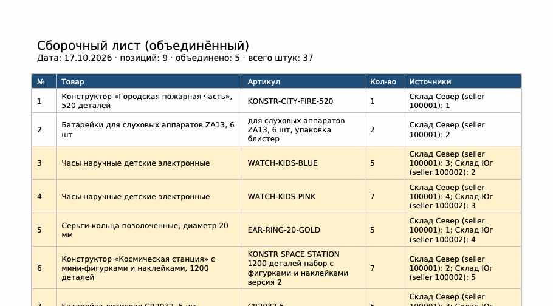

# ozon-assembly-merge

[](https://github.com/sakurajim4/ozon-assembly-merge/actions/workflows/tests.yml)


Склеивает PDF **сборочных листов Ozon** (`carriage_assembly_list_seller_*.pdf`) в один список: одинаковые артикулы суммируются в одну строку, видно, с какого склада сколько брать. Результат — XLSX, CSV или PDF для печати.

Ozon выгружает отдельный сборочный лист на каждую пару «магазин + склад отгрузки». Если у вас несколько магазинов или складов, за день набирается несколько PDF, и собирать заказы приходится по каждому листу отдельно. Утилита превращает их в один лист сборки.



## Установка

```bash
pip install git+https://github.com/sakurajim4/ozon-assembly-merge
```

Нужен Python 3.10+. Работает на Windows, macOS и Linux.

## Использование

```bash
# несколько файлов → XLSX рядом с первым файлом
ozon-assembly-merge carriage_assembly_list_seller_*.pdf

# вся папка, сразу в Excel и в PDF для печати
ozon-assembly-merge ~/Загрузки -o сборка.xlsx -o сборка.pdf

# CSV, отсортированный по количеству
ozon-assembly-merge *.pdf -o сборка.csv --sort qty
```

| Параметр | Что делает |
|---|---|
| `-o, --out ФАЙЛ` | куда сохранить; формат по расширению `.xlsx` / `.csv` / `.pdf`; можно указать несколько раз |
| `-f, --format` | формат, если `--out` не задан (по умолчанию `xlsx`) |
| `--sort` | `source` — как в листах (по умолчанию), `article`, `product`, `qty` |
| `--strict-dates` | остановиться, если листы за разные дни |
| `-q` | без сводки в консоли |

Пример вывода:

```
Файлов: 5
Строк на входе: 299
Уникальных артикулов: 281, из них объединено: 18
Всего штук (до и после объединения): 446
Сохранено: сборка.xlsx
```

В Excel два листа: «Объединённый список» со строкой ИТОГО и «Только объединённые» — позиции, которые встретились больше чем в одном листе. Объединённые строки подсвечены.

### Как библиотека

```python
from ozon_assembly_merge import parse_assembly_list, merge_lists, write

lists = [parse_assembly_list(p) for p in ["a.pdf", "b.pdf"]]
result = merge_lists(lists, sort="qty")
for item in result.merged_items:
    print(item.article, item.qty, item.sources_text())
write(result, "сборка.xlsx")
```

## Почему не «просто прочитать таблицу из PDF»

- В сборочных листах Ozon таблица без рамок ячеек: `extract_tables()` ничего не находит, а построчное чтение текста склеивает соседние ячейки многострочных товаров.
- Сетка восстанавливается по линиям: границы колонок берутся из линии под заголовком таблицы (5 сегментов), границы строк — из горизонтальных разделителей.
- **Ловушка:** текст ячейки центрирован по высоте строки, поэтому на второй и следующих страницах первая строка начинается *выше* первой линии страницы. Наивный разбор теряет первую строку каждой страницы-продолжения, причём без ошибок. Здесь это учтено, и есть регрессионный тест.
- Ключ объединения — **артикул**, а не название: одна модель разных цветов или размеров — это разные позиции.

## Самопроверки

Утилита не сохраняет результат и завершается с кодом 2, если:

- номера строк в листе идут не подряд (признак ошибки разбора);
- у строки не прочиталось количество;
- сумма штук до объединения не равна сумме после.

Предупреждения (в stderr): листы за разные даты; один артикул с разными названиями товара.

## Разработка

```bash
pip install -e ".[dev]"
pytest
```

Тесты сами генерируют синтетические сборочные листы в той же раскладке, что у Ozon (несколько страниц, многострочные ячейки, без рамок), — реальные листы с данными покупателей в репозитории не хранятся. Пример синтетического листа: [docs/input-synthetic.png](docs/input-synthetic.png).

Шрифт DejaVu Sans для PDF с кириллицей поставляется вместе с пакетом (лицензия — `src/ozon_assembly_merge/fonts/DejaVu-LICENSE.txt`).

## Лицензия

MIT

---

## English

**ozon-assembly-merge** merges several Ozon seller *assembly list* PDFs (`carriage_assembly_list_seller_*.pdf`, one per seller+warehouse pair) into a single picking list, summing quantities per article (SKU) and keeping a per-warehouse breakdown. Output: XLSX, CSV or PDF.

```bash
pip install git+https://github.com/sakurajim4/ozon-assembly-merge
ozon-assembly-merge *.pdf -o picking.xlsx -o picking.pdf
```

The PDFs have no cell borders, so the grid is rebuilt from the header separator (column bounds) and row separator lines. Continuation pages need a virtual top boundary, otherwise the first row of every page is silently dropped (covered by a regression test). The tool refuses to write output if row numbers have gaps, a quantity is unreadable, or totals differ before and after merging. Tests generate synthetic PDFs; no real customer data is stored in the repo.
